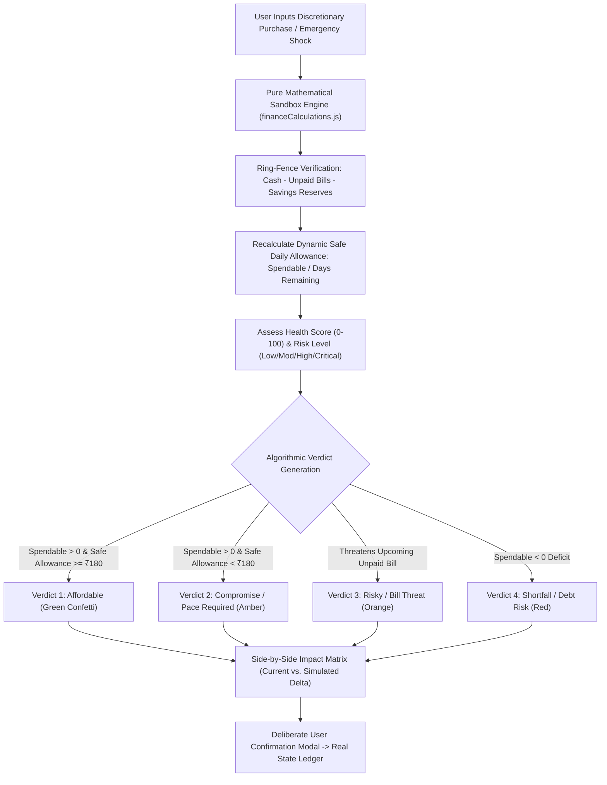

# RUNWAY 💸
> **Your money. Your next 30 days. Your decisions.**  
> *Challenge: “Broke But Functional — Survive the Month”*  
> **Live Production Deployment:** [https://runway11.netlify.app/](https://runway11.netlify.app/)

---

## 📖 Executive Summary

**RUNWAY** is an interactive personal finance simulation and decision engine designed for students and young professionals navigating a constrained **₹10,000 budget across 30 days**.

Traditional budgeting apps are passive: they record expenses *after* money has already left the user's pocket. For someone living paycheck-to-paycheck on ₹10,000, a single uninformed impulse purchase (like ₹1,500 sneakers or an expensive weekend trip) causes an irreversible cascade: unpaid rent, failed mobile recharges, and month-end debt.

RUNWAY flips this paradigm into **proactive decision intelligence**. It interconnects starting cash, income, actual expenses, fixed commitments, ring-fenced savings, financial risk, and financial health into a real-time reactive simulation. Users can simulate prospective purchases or sudden emergencies and immediately see the exact mathematical impact on their **remaining cash, spendable buffer, safe daily allowance, month-end trajectory, and risk level *before spending a single rupee***.

---

## ⚡ Core Product Capabilities

### 1. Financial Command Center
- **Starting Budget:** Strict ₹10,000 benchmark starting at **Day 1 of 30**.
- **Spendable Balance:** Automatically ring-fences unpaid commitments and savings goals to calculate the true discretionary cash remaining.
- **Safe Daily Spending Allowance:** Dynamically computed from uncommitted cash divided by the remaining days in the challenge (`Spendable ÷ Days Remaining`).
- **Financial Health Score (0–100):** A multi-factor algorithmic score evaluating budget adherence pace, fixed bill coverage, daily allowance viability, and savings cushion.
- **Financial Risk Evaluation:** Transparent risk scoring (Low, Moderate, High, Critical) providing early warnings for budget burn acceleration and upcoming bill threats.
- **Contextual Insights:** Dynamically generated tactical advisories based on impending bills and burn rates.

### 2. "Can I Afford This?" — Decision Simulator (Signature Feature)
- **Zero-Risk Sandbox:** Preview prospective expenses (presets or custom amounts) without modifying real account balances.
- **Side-by-Side Consequence Matrix:** Directly compares Current State vs. Simulated State across:
  - Cash in Hand
  - Spendable Buffer
  - Safe Daily Allowance
  - Projected Day 30 Month-End Balance
  - Financial Health Score
  - Financial Risk Level
- **Four Algorithmic Verdicts:**
  1. *Affordable within the current budget* (Green)
  2. *Affordable, but requires reduced spending elsewhere* (Amber)
  3. *Risky: may threaten upcoming commitments* (Orange)
  4. *Not affordable without a shortfall* (Red)
- **Deliberate Commit Action:** Requires an explicit user confirmation modal before recording any simulated purchase into the active ledger.

### 3. Shock Simulator (Unexpected Expenses)
- Stress-tests budget resilience against sudden emergency shocks:
  - **₹500 Minor Surprise:** Urgent pharmacy medicines or lost metro card.
  - **₹1,500 Moderate Shock:** Replacement laptop charger or auto-rickshaw breakdown.
  - **₹3,000 Major Crisis:** Room security deposit or urgent medical visit.
  - **Custom Amount:** Free-form numeric stress testing.
- Instantly illustrates daily allowance contraction and shortfall risks.

### 4. Fixed Commitments & Subscriptions Manager
- Track essential living obligations (e.g., Room Rent ₹3,500, Mobile Recharge ₹479, Wi-Fi Split ₹400).
- Categorized with due days (Day 1–30) and recurrence indicators.
- **Mathematical Integrity (Zero Double-Counting):** Marking a commitment as paid automatically records a ledger expense and removes it from pending unpaid commitments simultaneously, keeping spendable balance consistent.

### 5. Ring-Fenced Savings Goals
- Allocate funds toward dedicated targets (e.g., Emergency Buffer, Essential Gear).
- **Deposit & Withdraw:** Move funds dynamically between spendable cash and savings goals.
- **Ring-Fenced Protection:** Saved funds remain part of total liquid cash reserves while being strictly deducted from discretionary daily allowance.

### 6. 30-Day Trajectory & Burn Forecast Engine
- **Area Trajectory Chart (Recharts):** Real-time cumulative spending trajectory vs. ideal ₹10,000 linear burn rate vs. Day 30 projected outcome.
- **Category Spend Distribution:** Visual breakdown of expenditures with targeted cutback tips.
- **Reconciliation Arithmetic Table:** Transparent audit log itemizing starting balance, inflows, fixed outflows, variable spend, and projected Day 30 surplus/deficit.

### 7. 30-Day Survival Streak & Gamification Engine
- **Active Survival Streak:** Tracks consecutive days navigated without breaching safe daily burn velocity.
- **Discipline Badges:** Dynamically awards achievements including *Bill Shield* (0 overdue commitments), *Viable Runway* (safe allowance $\ge$ ₹120/day), and *Liquid Cushion* (emergency reserve intact).
- **Adaptive Survival Levels:** Gamified progression across 4 milestones: *Budget Recruit* (Days 1–7), *Spartan Pacer* (Days 8–14), *Strategic Survivor* (Days 15–24), and *Runway Master* (Days 25–30).

### 8. Interactive Challenge Timeline, Dual Themes & Mobile Polish
- **Interactive Day Slider (Day 1–30):** Progress forward day-by-day to observe changing daily allowances and commitment deadlines.
- **Day (Light) & Night (Dark) Mode:** Professionally calibrated dual-theme system featuring Apple-grade smooth cubic-bezier transitions (`cubic-bezier(0.16, 1, 0.3, 1)`).
- **Adaptive Mobile Layouts:** Automatic dual-view architecture providing full tables on desktop/tablet and touch-friendly cards on small mobile viewports ($<680\text{px}$).
- **Accessible Mobile Navigation:** Mobile bottom dock paired with an expandable "More" sheet and a 1-tap dismissible sidebar drawer.
- **State Persistence & Backup:** Automatic synchronization to browser `localStorage` (`runway_finance_state_v2`) with 1-click JSON backup export and reset to clean baseline.

---

## 🔄 Decision Simulation & Shock Architecture



---

## 📐 Mathematical Calculation Engine

All calculations are encapsulated in [`src/utils/financeCalculations.js`](file:///c:/Users/board/Downloads/New%20folder/src/utils/financeCalculations.js) with 100% test coverage:

### 1. Liquid Cash & Spendable Balance
$$\text{Current Cash} = \text{Starting Budget (₹10,000)} + \text{Income Received} - \text{Actual Expenses}$$

$$\text{Spendable Balance} = \text{Current Cash} - \text{Upcoming Unpaid Commitments} - \text{Reserved Savings}$$

### 2. Safe Daily Allowance
$$\text{Safe Daily Allowance} = \begin{cases} 
\left\lfloor \frac{\text{Spendable Balance}}{\text{Days Remaining}} \right\rfloor & \text{if } \text{Spendable Balance} > 0 \\ 
0 & \text{if } \text{Spendable Balance} \le 0 
\end{cases}$$
*Where $\text{Days Remaining} = \max(1, 30 - \text{Current Day} + 1)$.*

### 3. Projected Month-End Balance
$$\text{Projected Balance} = \text{Current Cash} + \text{Pending Income} - \text{Upcoming Bills} - (\text{Safe Daily Allowance} \times \text{Days Remaining})$$

### 4. Financial Health Score (0–100)
Composed of four weighted dimensions:
- **Budget Adherence (35 pts):** Compares actual spend against ideal linear burn to date.
- **Commitment Coverage (25 pts):** Ratio of current liquid cash to upcoming unpaid obligations.
- **Daily Runway Viability (25 pts):** Evaluates whether safe daily allowance meets minimum essential threshold (₹120/day).
- **Savings Cushion (15 pts):** Percentage of targeted savings goals funded and ring-fenced.

$$\text{Health Score} = S_{\text{budget}} + S_{\text{commitments}} + S_{\text{runway}} + S_{\text{savings}}$$

### 5. Financial Risk Score (0–100)
Inverse risk indicator identifying failure modes:
- **Spendable Deficit (+40 pts):** Uncommitted cash is negative or insufficient for near-term bills.
- **Burn Velocity (+25 pts):** Daily average spending exceeds safe allowance by $>25\%$.
- **Pending Bill Pressure (+20 pts):** Impending commitments due within 5 days exceed liquid cash.
- **Near-Zero Buffer (+15 pts):** Spendable buffer is under ₹800.

---

## 🏛️ Project Architecture & Directory Structure

```
runway-finance/
├── .github/
│   └── workflows/
│       └── deploy.yml              # GitHub Actions automated Pages deployment
├── netlify.toml                    # Netlify SPA redirects, headers, and asset caching
├── index.html                      # HTML5 shell with viewport-fit=cover & font preloading
├── package.json                    # Dependencies, scripts, and engine specifications
├── vite.config.js                  # Vite 8 config with manualChunks & code splitting
├── test_calculations.js            # Node test suite for financial formulas & edge cases
├── src/
│   ├── main.jsx                    # Application bootstrapping & DOM mounting
│   ├── App.jsx                     # Root component with React.lazy route code-splitting
│   ├── index.css                   # Design tokens, Apple motion, responsive & WCAG styles
│   ├── context/
│   │   ├── financeContextDef.js    # Decoupled React Context definition (fast-refresh safe)
│   │   ├── FinanceContext.jsx      # State provider, persistence, theme, and actions
│   │   └── useFinance.js           # Custom consumer hook
│   ├── data/
│   │   └── initialData.js          # Day 1 clean baseline (₹10,000 budget, 3 essential bills)
│   ├── utils/
│   │   ├── financeCalculations.js  # Pure arithmetic & simulation algorithm engine
│   │   ├── formatters.js           # Indian currency (₹) & date formatting helpers
│   │   └── categoryIcons.js        # Category metadata, colors, and badge definitions
│   └── components/
│       ├── Navbar.jsx              # Header with theme switcher, backup export, and pills
│       ├── Sidebar.jsx             # Desktop sidebar with timeline slider & fast-forward
│       ├── MobileBottomNav.jsx     # Mobile bottom navigation bar (WCAG 44px touch targets)
│       ├── Dashboard.jsx           # Financial command center & metric overview cards
│       ├── PurchaseSimulator.jsx   # "Can I Afford This?" decision matrix & presets
│       ├── UnexpectedExpenseSimulator.jsx # Emergency shock test sandbox
│       ├── CommitmentsManager.jsx  # Fixed recurring bills & subscriptions tracker
│       ├── TransactionsManager.jsx # Ledger entries with live search & type filtering
│       ├── SavingsManager.jsx      # Targeted savings goals with deposit/withdraw actions
│       ├── ForecastAnalytics.jsx   # Recharts burn trajectory & category breakdown
│       ├── CategoryBadge.jsx       # Isolated category badge component
│       ├── Modal.jsx               # Accessible dialog shell with Escape/backdrop handling
│       ├── AddTransactionModal.jsx # New expense/income record modal
│       ├── AddCommitmentModal.jsx  # New recurring bill modal
│       ├── AddSavingsGoalModal.jsx # New savings target modal
│       ├── SavingsActionModal.jsx  # Deposit/withdraw modal
│       ├── ConfirmDialog.jsx       # Two-step confirmation modal for destructive actions
│       └── Toast.jsx               # Feedback notification toaster
```

---

## 🚀 Performance & Code Quality Engineering

### 1. Bundle Splitting & Initial Payload
By leveraging `React.lazy`, `Suspense`, and Rolldown manual chunks (`vite.config.js`), the initial above-the-fold paint payload is dramatically reduced:

| Chunk | Gzip Size | Description |
| :--- | :--- | :--- |
| `index.html` | **0.96 kB** | Preloaded fonts, non-blocking CSS, accessible skip-link |
| `index-*.css` | **2.80 kB** | Design system tokens, responsive grid, Apple transitions |
| `index-*.js` | **15.85 kB** | Initial core application shell & Command Center |
| `vendor-react-*.js` | **64.96 kB** | React 19 core runtime |
| `vendor-icons-*.js` | **5.88 kB** | Lucide React lightweight icons |
| `vendor-charts-*.js` | *Deferred* | Recharts library loaded **only** on Forecast tab view |
| `PurchaseSimulator-*.js` | *Deferred* | Simulator module loaded on demand |
| `CommitmentsManager-*.js`| *Deferred* | Commitments module loaded on demand |

### 2. Static Code Quality (Oxlint)
- **Warnings:** `0`
- **Errors:** `0`
- Checked across 30 files with 104 linting rules in 37ms.
- 100% compliant with React Fast Refresh isolation rules.

### 3. Automated Test Suite (7 Verification Suites)
- Executed via `npm test` (`node test_calculations.js`).
- **Test 1:** Initial State Verification (Day 1 / ₹10,000 baseline arithmetic).
- **Test 2:** Purchase Simulation Delta & Verdict Logic (discretionary burn).
- **Test 3:** Emergency Shock Simulator Stress-Testing (sudden crisis absorption).
- **Test 4:** Edge Case Robustness (Day 30 zero-balance & boundary guards).
- **Test 5:** Bill Settlement Integrity (zero double-counting on paid obligations).
- **Test 6:** Savings Cushion Ring-Fencing (preserves liquid cash while protecting discretionary allowance).
- **Test 7:** Financial Health & Risk Scoring Grade Boundaries (0–100 scale adherence).

---

## ♿ Accessibility & Responsiveness Audit (WCAG 2.1 AA)

| Metric | Implementation Details | Compliance |
| :--- | :--- | :---: |
| **Skip Link** | Dedicated `.skip-to-content` link allowing keyboard users to bypass navigation directly to `#main-content`. | WCAG 2.4.1 |
| **Focus Rings** | High-contrast visible focus outline (`outline: 2px solid var(--accent-lime); outline-offset: 2px`). | WCAG 2.4.7 |
| **Form Labels** | All `<input>` and `<select>` elements paired with explicit `<label htmlFor="...">` and `id` references. | WCAG 1.3.1 / 4.1.2 |
| **Touch Targets** | Mobile buttons and navigation tabs feature minimum touch dimensions of `42px – 48px`. | WCAG 2.5.5 / 2.5.8 |
| **Reduced Motion** | `@media (prefers-reduced-motion: reduce)` block disables non-essential animations. | WCAG 2.3.3 |
| **Responsive Grid** | Tested across **320px, 375px, 768px, 1024px, and 1440px** viewports without horizontal clipping. | WCAG 1.4.10 |
| **Contrast Ratio** | Text colors exceed 4.5:1 contrast against surface backgrounds in both Day and Night themes. | WCAG 1.4.3 |

---

## 🛠️ Local Development & Build Commands

### Prerequisites
- Node.js (v18.0.0 or higher)
- npm (v9.0.0 or higher)

### 1. Installation
```bash
# Clone the repository
git clone https://github.com/<your-username>/runway-finance.git
cd runway-finance

# Install dependencies (Windows users: use npm.cmd if PowerShell restricts scripts)
npm install
```

### 2. Run Development Server
```bash
npm run dev
```
Open `http://localhost:5173` in your browser.

### 3. Run Calculation Test Suite
```bash
npm test
```

### 4. Run Oxlint Static Analysis
```bash
npm run lint
```

### 5. Build for Production
```bash
npm run build
```

### 6. Preview Production Build
```bash
npm run preview
```

---

## 🌐 Deployment Guides

### A. Netlify Deployment (Live at `runway11.netlify.app`)
The repository includes [`netlify.toml`](file:///c:/Users/board/Downloads/New%20folder/netlify.toml) configured with:
- **Build command:** `npm run build`
- **Publish directory:** `dist`
- **SPA Fallback:** `/* -> /index.html 200`
- **Security Headers:** Content-Security-Policy, X-Frame-Options, X-Content-Type-Options, Strict-Transport-Security.
- **Immutable Cache Control:** `Cache-Control: public, max-age=31536000, immutable` for all `/assets/*` bundles.

### B. GitHub Pages Deployment
The repository includes a ready-to-run GitHub Actions workflow (`.github/workflows/deploy.yml`):
1. Push your repository to GitHub (`main` branch).
2. Navigate to **Settings** -> **Pages**.
3. Under **Build and deployment** -> **Source**, select **GitHub Actions**.
4. The site will automatically build and deploy within 90 seconds.

---

## 📄 License
This project is open-source under the MIT License.
